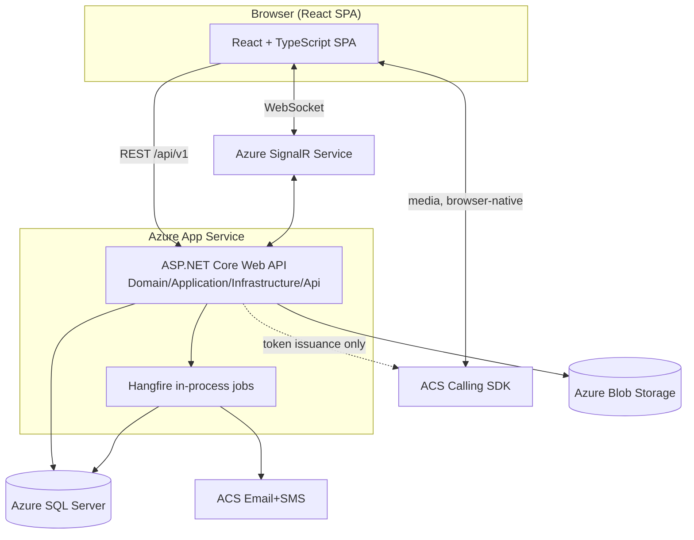

<!-- pipeline-provenance
produced_by: ai-spec-agent (architecture-profiler)
generated: 2026-09-11
inputs:
  - .aidlc/02-solution-designer/technical-design/final-tech-design.md
  - .aidlc/01-brd-analysis/brd-analyst/requirements.yaml
-->

# 03 — System Design (Architecture Profile)

## 1. Verdict — which conditional spec files exist

| Trigger | Verdict | Basis | Files this enables |
|---|---|---|---|
| **UI** | YES | 20 real-mockup-derived screens, `ui-design-final.md` | `11-ui-spec/` (sharded) |
| **ASYNC** | YES | SignalR real-time transport (T-001: chat/presence/typing/join-leave) + Hangfire background jobs (T-005: reports, notifications, rollover, retention sweep) | `06-event-contracts.md` |
| **LEGACY_DATA** | NO | FR-088 ("data migration from any specific incumbent system") is `status: excluded` in `requirements.yaml`; Tech Design §2.1 confirms no pre-existing system is integrated | No `13-data-migration-spec.md` produced |
| **DATA_PIPELINE** | NO | No ETL/batch-analytics capability described in BRD, requirements.yaml, or Tech Design | N/A |
| **ML** | NO | No model/inference capability anywhere in the three inputs | N/A |
| **multi-service** | NO | Tech Design §2.1: "one ASP.NET Core Web API + one React SPA... not a set of connected microservices" | No per-service shard axis; feature-slug sharding only (see `00-spec-index.md`) |

Getting this wrong in either direction is the exact failure this profiler exists to prevent: no
`13-data-migration-spec.md` is written despite the system having a database (because there is no
*migration from an external system*, only ordinary schema migrations, which are a `04-data-model.md`
concern, not a `13` concern); no per-service shard folders are created despite feature sharding,
because there is exactly one deployable API.

## 2. Application shape (restated from Tech Design §2, for this suite's own record)

Full-stack, multi-tenant SaaS. One ASP.NET Core Web API (Clean/Onion layering: Domain /
Application / Infrastructure / Api) + one React (TypeScript) SPA. Shared Azure SQL Server
database, `institution_id` row discriminator + EF Core global query filters as the tenant-isolation
mechanism (structural, not developer-discipline-based). Three Azure-native vendor dependencies
behind narrow contracts: Azure SignalR Service (real-time), Azure Communication Services
(email/SMS + live-meeting calling), Azure Blob Storage (report snapshots).

## 3. Component inventory (carried from Tech Design §2.2, re-stated as the spec suite's own index)

| Component | Builds/Connects | Feature slug (§4, `00-spec-index.md`) |
|---|---|---|
| Institution management & lifecycle | Builds | `institutions` |
| Identity/AuthN/AuthZ (RBAC) | Builds | `identity-access` |
| Student records + Parent-link | Builds | `academic-records` |
| Staff (teacher) records | Builds | `academic-records` |
| Class/Section/Subject | Builds | `academic-records` |
| Attendance | Builds | `attendance` |
| Announcements | Builds | `communication` |
| Collaboration rooms & messaging | Builds (logic) + Connects (SignalR) | `communication` |
| Live meetings | Connects (ACS Calling) | `communication` |
| Dashboards & reporting | Builds | `operations` |
| Scheduling | Builds | `operations` |
| Institution configuration & academic year | Builds | `configuration-commercial` |
| Commercial/subscription | Builds | `configuration-commercial` |
| Notifications (email/SMS) | Connects (ACS) | `configuration-commercial` (dispatch trigger sits in institution config), cross-referenced from `communication` |
| Background/async jobs | Builds (Hangfire framework) | cross-cutting — see `12-infrastructure-spec.md` §Jobs |
| Report/document storage | Connects (Azure Blob) | `operations` |

## 4. Sharding axis decided here for the profiler's own record

**Feature-slug axis only** (no service axis) — the seven slugs frozen in `01-source-catalogue.md`
§2: `institutions`, `identity-access`, `academic-records`, `attendance`, `communication`,
`operations`, `configuration-commercial`, plus the `_shared` cross-cutting file where a concern
shards. `ai-spec-sharding-planner`'s full shard map is authoritative and lives in
`00-spec-index.md` (written last); this file only records *that* sharding applies and on which
axis, per the profiler's own remit.

## 5. Requirements this architecture serves directly (carried from Tech Design §2.5)

NFR-020/021/022 (scale), NFR-016 (tenant isolation, structural), NFR-010 (availability — ops
layer, enabled by this design's stateless-API property).
