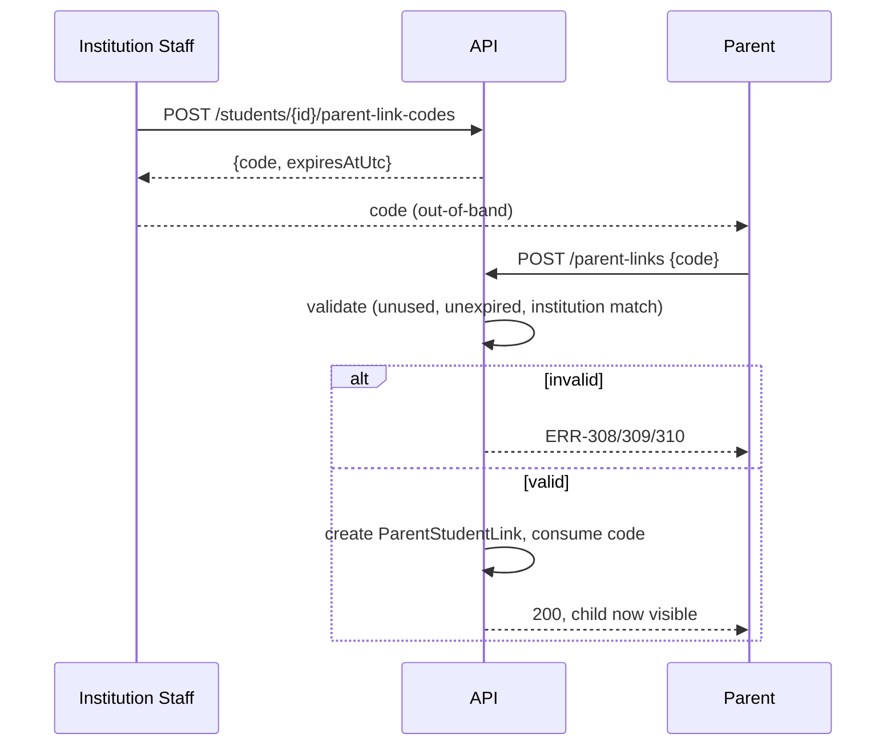

<!-- pipeline-provenance
produced_by: ai-spec-agent (process-flow-writer)
generated: 2026-09-11
-->

# 10 — Process Flows — `academic-records`

## PF-004 — Student enrolment

**Trigger:** Institution staff enrols a new student.
**Actors:** Administrator/Principal/SchoolInCharge.
**Pre-conditions:** caller is leadership of the target institution; a class exists to place the
student into.
**Post-conditions:** Student record active, placed in exactly one class, guardian details
recorded, eligible for attendance capture (BR-019).

**Steps:**
1. Staff submits student core details + class placement + guardian details (API-011).
2. System validates SR/roll-number uniqueness (BRL-018) and required fields (VAL-008–011).
3. Student record created, `class_id` set.
4. (Optional, later) staff links the record to a platform user account (API-015) — FR-016.
5. (Optional, later) staff issues a Parent Link Code (PF-005) so a Parent can self-register and
   gain linked access.

**Exception flows:**
- Step 2 duplicate → `ERR-301`.
- Step 1 omits class placement → rejected at `VAL-` level (class placement is required at
  enrolment per FR-011's field list, distinct from BR-019 which only gates *attendance*, not
  enrolment itself — enrolment without a class is not possible in this design since `class_id`
  is a required field on create).

**Exercised by:** `TC-301`–`TC-304`.

## PF-005 — Parent-to-Student linking (T-003, resolves FR-017)

**Trigger:** Staff wants to give a parent linked access to a student's records.
**Actors:** Institution staff (issuer), self-registering Parent (consumer).
**Pre-conditions:** student record exists.
**Post-conditions:** `ParentStudentLink` row exists; parent's scoped `GET` endpoints (FR-075) now
include this student.

**Steps:**
1. Staff issues a code against the student (API-016) — 8 chars, 7-day expiry.
2. Staff communicates the code out-of-band (matches the room-passcode pattern, T-003).
3. Parent registers (PF-002) or, if already registered, signs in.
4. Parent submits the code (API-018).
5. System validates: code exists, `Issued`, unexpired, institution matches (decision table,
   `07-business-logic/academic-records.md`).
6. `ParentStudentLink` created; code marked consumed (terminal).

**Exception flows:**
- Expired → `ERR-308`. Institution mismatch → `ERR-309`. Already consumed/revoked → `ERR-310`.

**Mermaid:**

**Exercised by:** `TC-305`–`TC-309` (including adversarial: expired code, wrong-institution code,
reuse-after-consumption).
