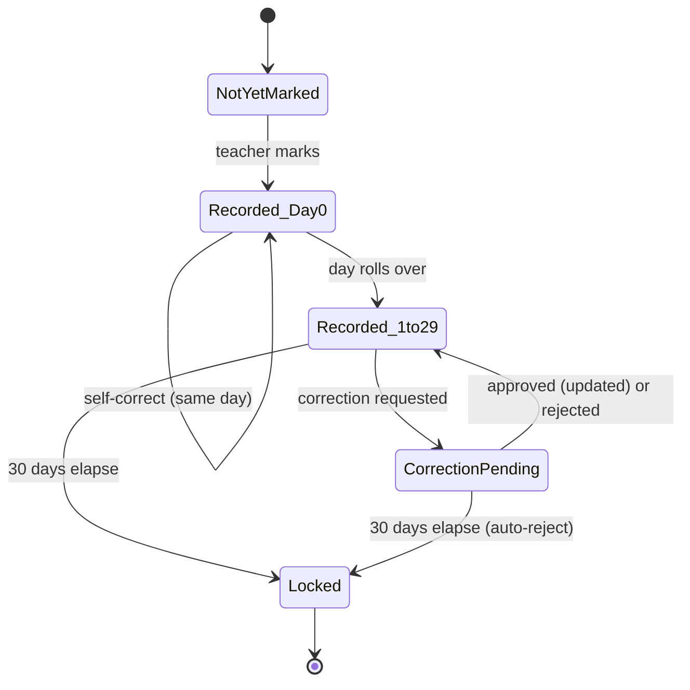

<!-- pipeline-provenance
produced_by: ai-spec-agent (process-flow-writer)
generated: 2026-09-11
-->

# 10 — Process Flows — `attendance`

## PF-006 — Daily attendance marking

**Trigger:** Teacher opens their class register for the day.
**Actors:** Teacher.
**Pre-conditions:** Teacher assigned to the class (or is class teacher); class has a roster.
**Post-conditions:** Every roster member has a recorded outcome, or remains NotYetMarked if the
teacher hasn't finished.

**Steps:**
1. Teacher opens roster for today (API-031) — every student shown NotYetMarked, never
   pre-populated as "Absent" (BRL-034).
2. Teacher marks each student Present/Absent/Late/Leave (bulk-capable, single toggle grid).
3. Teacher submits (API-032) — one bulk upsert transaction.
4. System writes/updates `AttendanceRecord` rows (upsert on `(person_id, attendance_date)`, D10).
5. Audit row written per entry (NFR-028).

**Exception flows:**
- Teacher attempts to submit a future date → `ERR-403`.
- Teacher re-submits later the same day → step 4 updates in place (BRL-031), no duplicate.

**Exercised by:** `TC-401`–`TC-404` (including the adversarial fixture proving default state is
NotYetMarked, not Absent).

## PF-007 — Attendance correction and approval (FR-033/034/035)

**Trigger:** A correction is needed for a previously recorded entry.
**Actors:** Teacher (requester, day 0 or day 1–29), Principal/SchoolInCharge/Administrator
(approver, day 1–29 only, per the Q-204 confirmed role mapping).
**Pre-conditions:** record exists, not yet Locked (≤30 days old).
**Post-conditions:** either the record is updated (same-day direct, or day 1–29 post-approval) or
the request is rejected/expired.

**Steps (day 0 — same day):**
1. Teacher edits their own entry directly (API-032 re-submit).
2. No approval step — applied immediately.

**Steps (day 1–29):**
1. Teacher (or leadership) submits a correction request (API-033) → `CorrectionPending`.
2. An approver reviews and approves/rejects (API-034).
3. On approve, the record updates and the request closes.
4. On reject, the record is unchanged, the request closes with a reason.

**Exception flows:**
- Request submitted after day 30 → `ERR-401`, no `CorrectionPending` created (state machine
  guard, `07-business-logic/attendance.md`).
- Record reaches day 30 while a request is still `CorrectionPending` → auto-rejected, record
  becomes Locked (Q-206, confirmed final rule) — this is a **scheduled** transition (Hangfire
  daily check), not merely evaluated lazily on next read, so a record does not appear
  correctable to an approver who happens to view it before the daily job runs but after the
  30-day boundary has passed; **[NEEDS ANSWER — Q-212, non-blocking]** — confirm whether the lock
  should be enforced as a scheduled sweep, a lazy per-request check, or both (provisional choice:
  both — the API-034 approve/reject action re-checks the boundary at the moment of action
  regardless of the sweep's last run, so the sweep is a convenience/consistency job, not the sole
  enforcement point).

**Mermaid (state view — full guard detail in `07-business-logic/attendance.md`):**

**Exercised by:** `TC-405`–`TC-412` (same-day, day-1, day-29, day-30-boundary, day-31-locked,
concurrent-request-rejection, leadership-self-correction).
