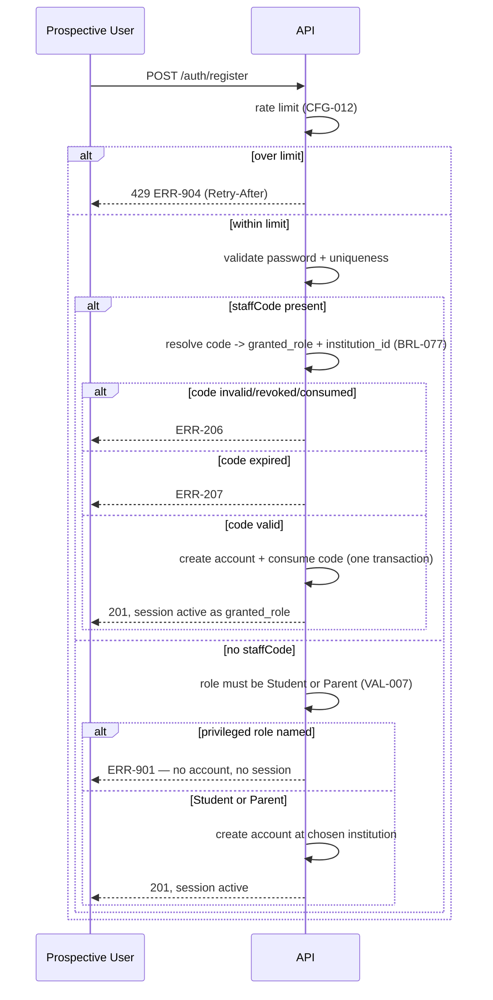

<!-- pipeline-provenance
produced_by: ai-spec-agent (process-flow-writer)
generated: 2026-09-11
revised: 2026-09-15 — spec_suite_version 1.0.4 (narrow patch, authorised by Rashmi Mehta at the
  Gate 4 CHANGES-REQUIRED verdict). PF-002 split into its two branches (Q-238/Q-239, U38) and
  PF-014 added for the sign-up-code issue/redeem/revoke lifecycle. `PF-` range is now 001–014.
revised: 2026-09-15 — spec_suite_version 1.0.5 (narrow patch, authorised by Rashmi Mehta, closing
  the Mode D Round-2 audit against 1.0.4). **PF-014 text only, no `PF-` added or renumbered:**
  step 2's compensating-control claim is corrected — short-lived-and-single-use does not contain a
  code that leaks inside its window; revocation does, and it now has TC-215 (U46). Step 5 states
  that API-068 shows PlatformOperator-issued codes to the institution's own leadership, which is
  the compensating control for the bootstrap escalation (U47 / SEC-009).
-->

# 10 — Process Flows — `identity-access`

## PF-002 — Self-registration and immediate access

**Revised at 1.0.4 (Q-238/Q-239 — U38).** This flow previously had one path in which the user
"selects institution and role". That single step is the vulnerability: it made the caller the
source of their own privilege.

**Trigger:** A prospective user submits the Register form (UI-005).
**Actors:** Prospective user — **`Student` or `Parent` on branch A; any code-gated role on branch
B** (`Teacher`, `Administrator`, `Principal`, `SchoolInCharge`). `PlatformOperator` on neither.
**Pre-conditions:** none (anonymous). **Branch B additionally requires a valid, unconsumed,
unexpired sign-up code (PF-014).**
**Post-conditions:** Active `UserAccount`, active session — no pending/approval state exists.
**On branch B, the redeemed code is `Consumed` in the same transaction.**

**Steps:**
1. **Rate limiter** evaluates the caller against `CFG-012` (`09-security-spec.md` §10). Over the
   threshold → `ERR-904`, and **nothing below runs**.
2. The user chooses a mode (UI-005's segmented control):
   - **Branch A (Student/Parent):** selects institution (typeahead against
     `GET /public/institutions`, API-005) and picks Student or Parent.
   - **Branch B (school staff):** enters their sign-up code. **No role and no institution is
     collected or transmitted.**
3. User submits username/email/password (API-006).
4. System validates password policy (BRL-014) and uniqueness (VAL-006).
5. System resolves role + institution per **BRL-075**:
   - Branch A — from the request body, `role` constrained to {Student, Parent} by VAL-007.
   - Branch B — from the redeemed code row (BRL-077). Any `role`/`institutionId` in the body is
     ignored outright (E4).
6. System creates the account, bound permanently to the resolved institution (BRL-008), and on
   branch B marks the code `Consumed` **in the same transaction**.
7. System issues access+refresh tokens; user is immediately signed in (FR-006).

**Exception flows:**
- Step 1 over the limit → `ERR-904` (429) with `Retry-After`; no account, no session.
- Step 4 fails policy → `ERR-201`, inline field error, password not submitted anywhere else.
- Step 4 fails uniqueness → `ERR-203`.
- Step 5 branch A, a privileged role named → **`ERR-901`, no account, no session** (N11/N12).
- Step 5 branch B, code unknown / revoked / consumed → `ERR-206`; expired → `ERR-207`. **No
  account is created and the code's state is unchanged** on every failure branch.
- Step 6 fails after the code was marked consumed → the whole transaction rolls back, so a code is
  never burned without producing an account.

**Mermaid:**


**Exercised by:** `TC-201`–`TC-204`, and **`TC-209`–`TC-211`, `TC-214`** (added 1.0.4). TC-209 is
the U38 regression test.

## PF-014 — Leadership/staff sign-up code: issue, redeem, revoke (added 1.0.4, Q-238)

**Trigger:** A school needs its first Administrator (bootstrap), or existing leadership needs to
add a staff member.
**Actors:** PlatformOperator (bootstrap only), leadership of the institution, the prospective
staff member.
**Pre-conditions:** the institution exists and is active.
**Post-conditions:** a `Consumed` code and exactly one new privileged account, or a `Revoked` /
`Expired` code and no account.

**Steps:**
1. **Bootstrap** — PlatformOperator creates the institution (API-001). The response carries the
   first `Administrator` code, in **the only response that ever contains its plaintext**. If it is
   lost or expires unused, API-065 re-issues.
2. The PlatformOperator conveys the code to the school out of band. *(No channel is specified —
   `09-security-spec.md` §10 does not cover out-of-band delivery, and T-004's notification channel
   is not bound in this release, per U30. The code is short-lived (`CFG-010`) and single-use,
   which is the compensating control.)*
   **Corrected at 1.0.5 (U46).** Short-lived-and-single-use bounds the *window*; it does nothing
   for a code that leaks **inside** that window, which is the case an unspecified channel actually
   creates. **The real control for a leaked code is revocation — step 5, API-067 — and until 1.0.5
   nothing in the suite tested it.** `TC-215` now asserts it adversarially: a code whose plaintext
   is already in a third party's hands must, once revoked, create no account. Naming the weaker
   control while the stronger one went unasserted is what U46 caught.
3. The first Administrator registers with it (PF-002 branch B).
4. **Thereafter** that Administrator issues codes in-app for further staff (API-066), choosing
   `grantedRole` ∈ {Administrator, Principal, SchoolInCharge, Teacher} (VAL-028).
5. Leadership may list (API-068) and revoke (API-067) any unconsumed code at any time — **including
   a code a PlatformOperator issued into their institution at API-065, which API-068 shows them
   with `issuedByUserId: null`** (SEC-009, added 1.0.5). That visibility, plus this revoke right, is
   the compensating control for the bootstrap escalation named in `09-security-spec.md` §1a.1.
   Tested by TC-216.
6. Unredeemed codes expire silently at `expires_at_utc` (`CFG-010`). **No sweep job is required** —
   expiry is evaluated at redemption time against the clock, exactly as `ParentLinkCode` does, so
   there is no background process to fail.

**Exception flows:**
- A Teacher, Student or Parent calls API-066 → `ERR-102` (N14).
- Leadership of another institution calls API-065 → `ERR-102`; API-066 has no `institutionId`
  parameter, so there is no cross-tenant issue path to attempt at all (N15).
- Revoke on a consumed code → `ERR-208`. Unlinking an existing staff account is a separate,
  explicit action (deactivate the account), never implied by revoking the code that created it.

**Mermaid:**
```mermaid
sequenceDiagram
    participant PO as PlatformOperator
    participant L as School leadership
    participant S as Prospective staff
    participant API as API
    PO->>API: POST /institutions (API-001)
    API-->>PO: 201 + leadershipCode (plaintext, once only)
    PO-->>L: conveys code out of band
    L->>API: POST /auth/register {staffCode}
    API-->>L: 201, session as Administrator; code Consumed
    L->>API: POST /leadership-codes {grantedRole:"Teacher"} (API-066)
    API-->>L: 201 + code (plaintext, once only)
    L-->>S: conveys code
    alt redeemed in time
        S->>API: POST /auth/register {staffCode}
        API-->>S: 201, session as Teacher; code Consumed
    else revoked first
        L->>API: POST /leadership-codes/{id}/revoke (API-067)
        S->>API: POST /auth/register {staffCode}
        API-->>S: ERR-206 — no account
    end
```

**Exercised by:** `TC-210`, `TC-211`, `TC-212`.

## PF-003 — Sign-in / sign-out lifecycle

See `07-business-logic/identity-access.md`'s session state machine for the full guarded
transition set; this flow is the request-level view of the same lifecycle (login → silent
refresh → logout/expiry), exercised by `TC-205`–`TC-208`.
