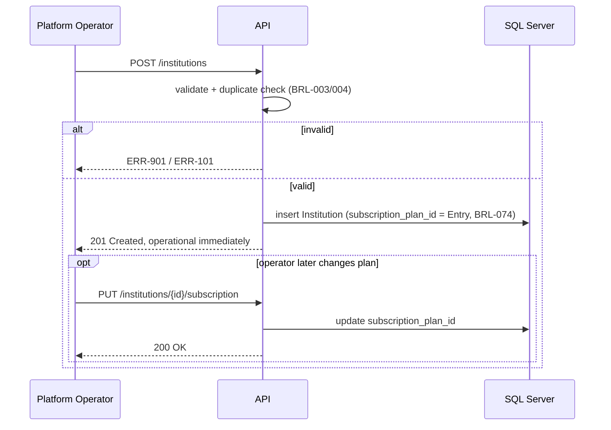

<!-- pipeline-provenance
produced_by: ai-spec-agent (process-flow-writer)
generated: 2026-09-11
-->

# 10 — Process Flows — `institutions`

## PF-001 — Institution onboarding

**Trigger:** Platform Operator decides to onboard a new institution.
**Actors:** Platform Operator.
**Pre-conditions:** Operator is authenticated with the PlatformOperator role.
**Post-conditions:** Institution exists, `is_active=true`, automatically assigned the Entry/Free
plan (`subscription_plan_id` set to the Entry tier, never null) at the moment of creation, and
operational immediately within that plan's limits (BRL-074). Platform Operators may later
upgrade or change the assigned plan (FR-003, SPEC-FR-003) — this is a subsequent, optional action,
not a precondition for the institution being usable.

*(Q-211, resolved: operator-confirmed 2026-09-11 by Jayesh Idnani. The prior provisional choice —
no plan assigned at registration, `subscription_plan_id` nullable until FR-003 runs, treated as
zero-capacity — is superseded; it would have contradicted `final-brd.md` §5's "onboarded and made
fully operational within one working day" success criterion by leaving a fresh institution
capacity-blocked until a Platform Operator remembered a separate plan-assignment step.)*

**Steps:**
1. Operator submits institution details (API-001).
2. System validates fields (VAL-001–004) and the composite duplicate check (BRL-003).
3. System creates the institution record, auto-assigning the Entry/Free plan (BRL-074) — no
   separate plan-selection step in this flow.
4. Institution appears in the public directory (API-005) using only name/city/region.
5. *(Optional, later, separate flow)* Operator upgrades/changes the plan (API-003 / SPEC-FR-003).

**Exception flows:**
- Step 2 fails validation → `ERR-901`, form re-shown with field errors.
- Step 2 fails duplicate check → `ERR-101`, operator informed which fields matched.

**Mermaid:**

**Exercised by:** `TC-101`–`TC-104` (`14-test-spec/institutions.md`).
