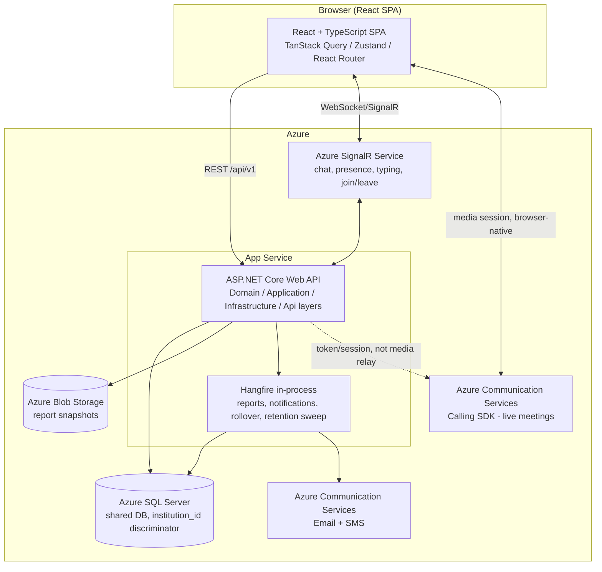

<!-- pipeline-provenance
produced_by: tech-design-agent
plugin_version: 0.3.0 (sdlc-greenfield-v3)
model: claude-sonnet-5
generated: 2026-09-11
phase: 3 (final — all Decides/Spike answered, merged with Phase 1 stated decisions)
inputs:
  - .aidlc/01-brd-analysis/brd-analyst/final-brd.md
  - .aidlc/01-brd-analysis/brd-analyst/requirements.yaml
  - .aidlc/02-solution-designer/ui-designer/design-tokens.md
  - .aidlc/02-solution-designer/technical-design/_decisions.md (D1–D14, all stand as written)
  - .aidlc/02-solution-designer/technical-design/_questions.md (T-001–T-006, SP-001 — all answered by Jayesh Idnani)
  - .aidlc/_config/company.md
  - .aidlc/_config/project.md
diagrams: self-reviewed, not machine-validated
-->

# Technical Design — School Management System ("SchoolSync")

## 1. Document Header

- **Project:** School Management System
- **Source of truth for this document:** `.aidlc/01-brd-analysis/brd-analyst/final-brd.md` (business contract — never
  re-opened here) + `.aidlc/01-brd-analysis/brd-analyst/requirements.yaml` (the requirement spine, all IDs
  `priority: must`, `priority_source: confirmed` except the 13 explicitly `excluded` IDs).
- **Design tokens:** `.aidlc/02-solution-designer/ui-designer/design-tokens.md`, confirmed by Jayesh Idnani,
  2026-09-11. Every color/size/spacing value in §4 cites a token name from that file — never a raw
  hex/px.
- **Decision inputs merged into this document:**
  - Stated Decisions D1–D14 (`_decisions.md`) — carried verbatim, no overrides received.
  - Worksheet items T-001–T-006 and SP-001 (`_questions.md`) — all answered by Jayesh Idnani on
    2026-09-11. T-006/SP-001 answered as a **waived-spike acceptance**: the leaning candidate
    (Azure Communication Services Calling SDK) is accepted now, and SP-001's five validation
    points are carried forward below as **named, owned risks** (§13), not closed findings.
- **Status:** Phase 3 — final. Ready for Gate 2 (readiness reported only; approval is the
  architect's/operator's call).
- **Team mode:** `team` per `project.md` §1a — Gate 2 approval sits with the named Architect
  (Jayesh Idnani).
- **Archetype (from Step 0 of the worksheet, restated for the record):** Full-stack, multi-tenant
  SaaS. Builds its own frontend, backend, database and identity/authorization end-to-end. Does
  not connect to any pre-existing institutional system (BRD explicitly excludes incumbent-system
  migration, FR-088). Two externally-sourced capabilities: real-time transport (T-001) and live
  meetings (T-006), both vendor-decided below.

---

## 2. Application Overview & Architecture

### 2.1 What this application is

A single ASP.NET Core Web API + React SPA solution, deployed as one Azure App Service (API) and
one static-hosted SPA (or served from the same App Service — see §15 for the deployment-topology
note, out of scope for code-level design), backed by one shared Azure SQL Server database using
row-level tenant discriminators. It is **not** a set of connected microservices and does not
integrate with any pre-existing school system — every capability in BRD §6.1–§6.13 is built by
this codebase.

Two vendor dependencies sit behind narrow integration contracts (§6): Azure Communication
Services (email, SMS, and live meeting calling) and Azure SignalR Service (real-time transport
backplane). Everything else — data model, business rules, RBAC, reporting, scheduling,
subscription/tiering — is native application logic.

### 2.2 Component inventory

| Component | Builds or Connects | Requirement anchor |
|---|---|---|
| Institution management & lifecycle | Builds | ENT-001, FR-001–005, BR-001–006 |
| Identity/AuthN/AuthZ (RBAC) | Builds | ENT-002, FR-006–010, BR-007–016 |
| Student records | Builds | ENT-003/004, FR-011–017, BR-017–021 |
| Staff (teacher) records | Builds | ENT-005, FR-018–023, BR-022–025 |
| Class/Section/Subject | Builds | ENT-006/007, FR-024–029, BR-026–029 |
| Attendance | Builds | ENT-008, FR-030–037, BR-030–035 |
| Announcements | Builds | ENT-009, FR-038–042, BR-036–039 |
| Collaboration rooms & messaging | Builds (chat logic) + **Connects** (real-time transport, T-001) | ENT-010/011, FR-043–047, 050–051, BR-040–045 |
| Live meetings | **Connects** (media/calling vendor, T-006) | ENT-012, FR-048–050, BR-046–047 |
| Dashboards & reporting | Builds | ENT-013, FR-052–058, BR-048–052 |
| Scheduling | Builds | ENT-014, FR-059–062, BR-053–056 |
| Institution configuration & academic year | Builds | ENT-016/017, FR-063–068, BR-057–060 |
| Commercial/subscription | Builds | ENT-015, FR-069–073, BR-061–064 |
| Notifications (email/SMS) | **Connects** (T-004) | FR-065 |
| Background/async jobs | Builds (T-005 framework) | FR-054/055, FR-065, FR-067/068, CMP-001/002 |
| Report/document storage | **Connects** (Azure Blob Storage, D11) | FR-055 |

No component here is invented beyond what the BRD requires — there is no admin-facing REST
surface for a system that does not exist, and no speculative service boundary.

### 2.3 Technology stack (from `company.md` §2 / `project.md` §2, plus the answered Decides)

| Layer | Choice | Basis |
|---|---|---|
| Backend runtime/framework | C# / .NET, ASP.NET Core Web API | `company.md` §2, `project.md` §2 |
| Frontend | React (TypeScript) | `company.md` §2, `project.md` §2 |
| Primary datastore | SQL Server (Azure SQL) | `company.md` §2 |
| Hosting | Microsoft Azure (App Service) | `company.md` §2 |
| Real-time transport | SignalR + Azure SignalR Service | **T-001**, answered |
| Multi-tenancy model | Shared DB, `institution_id` discriminator, EF Core global query filters | **T-002**, answered |
| Notification vendor (email/SMS) | Azure Communication Services | **T-004**, answered |
| Background jobs | Hangfire, in-process, SQL Server storage | **T-005**, answered |
| Live meetings | Azure Communication Services Calling SDK | **T-006**, answered (risks carried forward, §13) |
| Report/document storage | Azure Blob Storage + SQL metadata row | D11 |

### 2.4 High-level architecture



### 2.5 Requirements this architecture directly serves

NFR-020 (many institutions concurrently), NFR-021 (tenant-size range), NFR-022 (attendance-peak
absorption via horizontally-scalable App Service + SignalR backplane so no sticky-session
bottleneck), NFR-016 (absolute tenant isolation, structural via T-002), NFR-010 (99.5% availability
— addressed at the deployment layer, noted as out of scope in §15 but the stateless API design
here is what makes that layer's job possible).

---

## 3. Backend / Application Logic

### 3.1 Layering (D13)

Clean/Onion-style layering as separate projects within one ASP.NET Core solution:

- **`Domain`** — entities (Institution, User, Student, Teacher, Class, Subject, AttendanceRecord,
  Announcement, Room, Message, Meeting, Report, TimetablePeriod, SubscriptionPlan,
  InstitutionConfiguration, AcademicYear/Term, ParentStudentLink), value objects, and business
  rule enforcement that does not depend on EF Core or HTTP.
- **`Application`** — use-case/service layer (e.g. `EnrolStudentHandler`, `MarkAttendanceHandler`,
  `PromoteRosterHandler`), DTOs, validation, the institution-scoping contract each handler must
  honor.
- **`Infrastructure`** — EF Core `DbContext` and configurations (including the global query
  filters, D4/T-002), the Hangfire job definitions (T-005), the ACS email/SMS/calling clients
  (T-004/T-006), the SignalR hub implementations (T-001), the Azure Blob Storage client (D11).
- **`Api`** — ASP.NET Core Web API controllers (D5), authentication/authorization middleware,
  request/response mapping, SignalR hub route registration.

**Rationale:** standard layering for a .NET Web API of this size; keeps domain logic unit-testable
independent of EF Core/HTTP, per `company.md` §7's unit + integration split.

### 3.2 API style (D5)

RESTful JSON over ASP.NET Core Web API controllers, URL-versioned: `/api/v1/institutions`,
`/api/v1/students`, `/api/v1/attendance`, etc. See §7 for the endpoint inventory.

### 3.3 RBAC / multi-tenancy enforcement (D4, T-002)

- **Roles (BR-007):** PlatformOperator, Administrator, Principal, SchoolInCharge, Teacher,
  Student, Parent — a closed, finite set. Implemented as ASP.NET Core policy-based authorization.
- **Claims:** JWT carries `sub` (user id), `role`, and `institution_id`. Every controller action
  is annotated with a policy requiring one or more of the seven roles; policies are the only place
  role logic is expressed (no scattered `if (role == ...)` checks in handlers).
- **Institution scoping (T-002):** every tenant-owned `DbSet<T>` has an EF Core global query
  filter `HasQueryFilter(e => e.InstitutionId == _currentInstitutionAccessor.InstitutionId)`,
  applied via a shared `IEntityTypeConfiguration<T>` base or convention so it cannot be omitted
  per-entity. The `PlatformOperator` role is the only one permitted to bypass this filter, and
  only through an explicitly named cross-tenant query path (`IgnoreQueryFilters()` used solely
  inside a `PlatformOperatorQueryService`, never ad hoc in a handler) — satisfies BR-013 and
  NFR-016's "absolute isolation... sole bounded exception" requirement structurally, not by
  developer discipline.
- **Platform-global tables** (not institution-scoped): `SubscriptionPlan` catalogue,
  `PublicInstitutionDirectoryProjection` (FR-005 — read-only projection of name + city/region
  only, refreshed from `Institution` on write).
- Traces: BR-007–013, BR-009, NFR-015, NFR-016.

### 3.4 Real-time transport (T-001)

SignalR hub(s) — a `CollaborationHub` handling: message send/receive (FR-045), presence
(FR-047), typing indicators (FR-047), join/leave notices (FR-047, FR-050) — backed by Azure
SignalR Service in "Default" mode as the scale-out backplane, so App Service instances can scale
horizontally under NFR-022's attendance-day traffic peaks without sticky sessions. Group
membership = room id; the hub authorizes group-join against the room's passcode-verified session
(never re-checks the passcode on every message — verified once at join, per BR-041).

Reconnection: SignalR's built-in automatic reconnect handles NFR-012's "interrupted sessions
reconnect automatically"; on reconnect the client re-fetches message history from the REST API
(`GET /api/v1/rooms/{id}/messages`) to "restore conversation history" per NFR-012, since SignalR
reconnect alone does not replay missed messages.

### 3.5 Background/async jobs (T-005)

Hangfire, self-hosted in-process in the same App Service, SQL Server storage provider. Job
definitions:

| Job | Trigger | Requirement |
|---|---|---|
| Report generation | On-demand enqueue from `POST /api/v1/reports` | FR-054/055 |
| Notification dispatch (email/SMS) | Enqueued on announcement publish, attendance events, etc., per institution notification config | FR-065 |
| Academic year rollover | Scheduled (institution's configured academic-year end) + on-demand trigger | FR-067/068, BR-060 |
| Retention/deletion sweep | Scheduled daily | CMP-001/002/003 |

Each job is institution-scoped where applicable (rollover, notification dispatch) and runs inside
the same global-query-filter discipline as request-path code (the job's execution context sets
the `institution_id` accessor explicitly, since there is no HTTP request to derive it from).

### 3.6 Audit logging (D9)

A dedicated `AuditLog` table (actor user id, institution id, action, entity type, entity id,
before/after snapshot as JSON, timestamp UTC, correlation id), populated via an EF Core
`SaveChanges` interceptor so no individual endpoint can forget to write an audit row. Satisfies
NFR-028–033, BR-059 (`L4`, no separate decision needed), BR-039, BR-044.

Sign-in/sign-out/permission-denial events (NFR-031) are logged the same way from the
authentication middleware, not the `SaveChanges` interceptor (they are not entity changes).

### 3.7 Academic year / term modeling (D14)

`AcademicYear` and `Term` are first-class entities (ENT-017). Rollover (FR-067/068) creates a new
year-scoped `Enrollment`/`ClassRosterHistory` row per promoted student rather than mutating the
live roster in place — prior years' rosters, class allocations and attendance stay queryable and
read-only exactly as BR-060 requires. Leadership's override/hold-back (FR-067) is applied as an
exception list evaluated against the automatic-promotion job before it commits, or as a
post-hoc correction creating a new `Enrollment` row (never editing history).

### 3.8 Parent-to-Student association (T-003, resolves FR-017)

- `ParentLinkCode` entity: student id, code (8-char random, single-use), issued-by (staff user
  id), issued-at, expires-at (7 days from issue), consumed-at (nullable), consumed-by-user-id
  (nullable), revoked-at (nullable).
- Staff generate a code against a student record (any time after enrolment, FR-011); regenerable
  if unused/expired.
- A self-registering Parent (FR-006) submits the code during/after registration; validated
  (unused, unexpired, belongs to an institution matching the parent's chosen institution) and
  creates a `ParentStudentLink` row (many-to-many: `parent_user_id`, `student_id`) — supports
  BR-066's "linked children" plural.
- Consumed codes cannot be reused. Staff can revoke an unconsumed code or unlink a pair later.
- No additional identity-proofing introduced (matches FR-006's no-approval-step posture).
- Traces: FR-017 (BRD-deferred item, now resolved), FR-075, BR-066.

### 3.9 Notification delivery (T-004)

Azure Communication Services for both email and SMS, dispatched via the Hangfire notification job
(§3.5), driven by each institution's `InstitutionConfiguration.NotificationPreferences`
(FR-065). In-platform alerts are delivered over the same SignalR channel as chat (T-001) rather
than a separate channel.

---

## 4. Frontend Architecture

### 4.1 Stack (D6)

React + TypeScript SPA. **TanStack Query (React Query)** for server-state/data-fetching and
caching; **Zustand** for local/UI state (active room, meeting media mute/camera state);
**React Router** for routing. Component library: **shadcn/ui + Radix primitives**, themed via
Tailwind config bound to the tokens in `design-tokens.md` (operator decision, 2026-09-11 —
recorded there, not re-decided here).

### 4.2 Design tokens — cited by name only

Every value below is a token name from `.aidlc/02-solution-designer/ui-designer/design-tokens.md`; no raw
hex/px value is introduced in this design.

- **Color:** `color-primary` / `color-primary-hover` for primary actions and active nav (NFR-001
  role-aware nav); `color-primary-subtle-bg` + `color-primary-subtle-text` for badges and
  selected-nav background; `color-surface` / `color-background` / `color-border` /
  `color-border-subtle` for page and card chrome; `color-text-primary` / `-secondary` /
  `-tertiary` / `-quaternary` for the text hierarchy; `color-success` for the "Present" attendance
  pill; `color-error` for "Absent" and destructive/form-error states (NFR-003's destructive-action
  confirmation styling); `color-warning-bg` + `color-warning-text` (the AA-corrected pairing from
  design-tokens §1a) for the "Late" pill — the mockup's original solid `amber-500`/white
  combination is **not** carried into the build, per that file's binding instruction; `color-info`
  for the "Leave" pill.
- **Typography:** `text-display` for the public marketing hero; `text-h1` for section titles;
  `text-h2` for card/panel titles; `text-body-lg` for lead paragraphs; `text-body` default body;
  `text-body-sm` for nav labels/buttons/secondary text; `text-caption` for timestamps and stat
  labels; `text-micro-label` for eyebrow labels.
- **Spacing:** `space-1`…`space-16` (4px scale) for all margin/padding/gap values — no ad hoc
  pixel spacing.
- **Radii/elevation:** `radius-sm`/`radius-md` for controls/buttons/inputs; `radius-lg`/`radius-xl`
  for panels/modals/large cards; `radius-full` for pills/avatars/badges; `elevation-card` for
  default card shadow; `elevation-glow-primary` for primary CTA emphasis.
- **Breakpoints:** `bp-sm`/`bp-md`/`bp-lg`/`bp-xl` drive the responsive layout required by
  NFR-025.
- **Iconography:** `lucide-react`, using the nav-item mapping table in design-tokens §6
  (`layout-dashboard`, `layers`, `user-round`, `graduation-cap`, `clipboard-check`, `megaphone`,
  `video`, `settings`, `calendar-days`, `bar-chart-3`); icon sizes `icon-sm`/`icon-md`/`icon-lg`.

### 4.3 Component inventory reused from design-tokens §8

Button, top/side nav (role-filtered per BR-007 role set — NFR-001), card/panel, modal, status
pill/badge (attendance outcomes, D14/FR-031 mapped to `color-success`/`color-error`/
`color-warning-*`/`color-info`), toast notification (NFR-003 feedback), data table (extended
to student/teacher/class/attendance lists beyond the mockup's plan-comparison table), attendance
grid (roster with per-row Present/Absent/Late/Leave toggle, BR-034's default-not-present state),
chat panel (`chatLog`/`chatInput`, FR-045–047), avatar with presence-dot overlay (FR-047
presence).

**Explicitly not built:** the mockup's `roleSwitcher` demo affordance — BRD binds one role per
account at registration (BR-008); this is a mockup-only dev convenience and must not appear in
the shipped product UI, per design-tokens §8's own flag.

### 4.4 Screen build source (per design-tokens §9)

Real mockup: Public Home/About/Pricing/Contact, Auth modal, App shell. Partial (component real,
screen narrative-derived): Dashboard, Attendance roster marking, Collaboration/meetings. Fully
narrative-derived (BRD text only): Classes, Teachers, Students, Announcements, Settings,
Schedule, Reports. Payment and Leave nav entries are explicitly **not built**, even as
"coming soon" placeholders, since fee/payroll and leave workflow are out of scope (FR-081/082).

### 4.5 Role-aware navigation (NFR-001, NFR-009's counterpart usability rule NFR-002)

Side nav renders from a nav config filtered by the signed-in user's role claim — mirrors BRD §2's
RBAC directly in the client shell, in addition to (never instead of) server-side authorization
(FR-009/010, NFR-015).

### 4.6 Live meeting client (T-006)

Meeting UI (mic/camera controls, participant tiles — FR-049) is built against the Azure
Communication Services Calling SDK's browser JS client. Browser-only, no native app — matches
NFR-026 and the BRD's "no native mobile apps" exclusion (FR-087). See §13 for the carried-forward
validation risks on participant cap, reconnection, and browser compatibility that this UI must
be built to tolerate gracefully (e.g. a visible "reconnecting..." state) until confirmed.

### 4.7 Accessibility (NFR-005)

WCAG 2.1 AA baseline for all built screens; the one identified token-level contrast defect
("Late" pill) is already corrected at the token layer (design-tokens §1a) — the frontend must
consume `color-warning-bg`/`color-warning-text`, never the mockup's original amber-500/white pair.

---

## 5. Data Model & Database Design

### 5.1 Multi-tenancy model (T-002)

Shared database; every tenant-owned table carries `institution_id` (FK to `Institution`), enforced
via EF Core global query filters (§3.3). Platform-global tables (no `institution_id`):
`SubscriptionPlan`, `PublicInstitutionDirectoryProjection`, `AuditLog` (carries `institution_id`
as a column but is queried across tenants only by the Platform Operator path).

### 5.2 Soft-delete / reversible deactivation (D8)

Uniform `IsActive` (bool) + `DeactivatedAtUtc` (nullable) on `Institution`, `Student`, `Teacher`,
`Room`, and `UserAccount`. No physical delete on these — required for reversibility (BR-005,
FR-014, FR-019, FR-004) and to avoid orphaning history (BR-025).

### 5.3 Attendance concurrency (D10)

Unique constraint on `AttendanceRecord (person_id, attendance_date)`. A repeat submission is an
upsert (BR-031) — never a duplicate row. `person_type` discriminator (Student | Teacher) plus
`person_id` lets one table serve both FR-030 and FR-032.

### 5.4 Report/document storage (D11)

`ReportRun` metadata row in SQL Server (institution id, report type, generated-at, generated-by,
blob pointer) + the generated file itself (PDF/CSV, D7) in Azure Blob Storage. Retained
indefinitely per FR-055, subject to CMP-001/002 at the underlying student/staff-data level (the
report snapshot itself is not separately time-boxed beyond the general retention sweep).

### 5.5 Directory search (D12)

`PublicInstitutionDirectoryProjection` (institution name, city/region only — FR-005, NFR-016),
queried via SQL Server `LIKE`/basic full-text search. No dedicated search engine at this scale
(D12 rationale).

### 5.6 Academic year rollover (D14, §3.7)

`AcademicYear`, `Term` as first-class entities. `Enrollment` (or `ClassRosterHistory`) is a
year-scoped, append-only snapshot — never mutated post-rollover, satisfying BR-060's "historical
data intact and read-only."

### 5.7 Parent-Student linking (T-003, §3.8)

`ParentLinkCode` (single-use, time-limited) and `ParentStudentLink` (many-to-many) as described in
§3.8.

### 5.8 Entity-Relationship Diagram

```mermaid
erDiagram
    INSTITUTION ||--o{ USER_ACCOUNT : "employs/enrols"
    INSTITUTION ||--o{ STUDENT : has
    INSTITUTION ||--o{ TEACHER : has
    INSTITUTION ||--o{ CLASS : has
    INSTITUTION ||--o{ SUBJECT : has
    INSTITUTION ||--o{ ANNOUNCEMENT : publishes
    INSTITUTION ||--o{ ROOM : hosts
    INSTITUTION ||--o{ ACADEMIC_YEAR : defines
    INSTITUTION ||--|| INSTITUTION_CONFIGURATION : configures
    INSTITUTION }o--|| SUBSCRIPTION_PLAN : "subscribes to"

    USER_ACCOUNT }o--|| INSTITUTION : "bound to (BR-008)"
    USER_ACCOUNT ||--o| STUDENT : "optionally linked (FR-016)"
    USER_ACCOUNT ||--o| TEACHER : "optionally linked (FR-023)"
    USER_ACCOUNT ||--o{ PARENT_STUDENT_LINK : "parent of"

    STUDENT ||--o{ PARENT_STUDENT_LINK : "linked via"
    STUDENT }o--|| CLASS : "placed in (BR-017)"
    STUDENT ||--o{ ATTENDANCE_RECORD : has
    STUDENT ||--o{ PARENT_LINK_CODE : "issued for"
    STUDENT ||--o{ ENROLLMENT : "year-scoped roster row"

    TEACHER ||--o| CLASS : "class teacher of (BR-023)"
    TEACHER ||--o{ ATTENDANCE_RECORD : has
    TEACHER }o--o{ SUBJECT : "assigned to teach (BR-024)"

    CLASS ||--o{ STUDENT : contains
    CLASS ||--o{ TIMETABLE_PERIOD : scheduled
    CLASS }o--o{ SUBJECT : "mapped (FR-029)"

    ROOM ||--o{ MESSAGE : contains
    ROOM ||--o| MEETING : "may host"
    ROOM }o--|| USER_ACCOUNT : "created by"

    ACADEMIC_YEAR ||--o{ TERM : contains
    ACADEMIC_YEAR ||--o{ ENROLLMENT : "rollover creates"

    ANNOUNCEMENT }o--|| USER_ACCOUNT : "authored by"
    AUDIT_LOG }o--|| USER_ACCOUNT : "actor"
    REPORT_RUN }o--|| INSTITUTION : "scoped to"
```

### 5.9 Key sequence — Daily attendance marking (FR-030–035, BR-034)

```mermaid
sequenceDiagram
    participant T as Teacher (SPA)
    participant API as ASP.NET Core API
    participant DB as SQL Server

    T->>API: GET /api/v1/classes/{id}/roster?date=today
    API->>DB: SELECT students WHERE class_id, institution_id (query filter)
    DB-->>API: roster
    API-->>T: roster, all defaulted to "not present" (BR-034)
    T->>API: PUT /api/v1/attendance (bulk outcomes)
    API->>DB: UPSERT AttendanceRecord ON (person_id, attendance_date) (BR-031)
    API->>DB: write AuditLog row (SaveChanges interceptor, D9)
    API-->>T: 200 OK
    Note over T,API: From day+1, correction requires Principal/VP/Academic-Admin approval (FR-034);<br/>locked entirely after 30 days (FR-035)
```

### 5.10 Key sequence — Parent Link Code (T-003)

```mermaid
sequenceDiagram
    participant Staff as Institution Staff (SPA)
    participant API as API
    participant Parent as Parent (self-registering)

    Staff->>API: POST /api/v1/students/{id}/parent-link-codes
    API->>API: generate 8-char single-use code, 7-day expiry
    API-->>Staff: code (communicated out-of-band, mirrors room-passcode pattern)
    Parent->>API: POST /api/v1/auth/register (role=Parent, institution)
    Parent->>API: POST /api/v1/parent-links {code}
    API->>API: validate unused, unexpired, institution match
    API->>API: create ParentStudentLink; mark code consumed
    API-->>Parent: 200 OK — child now visible under FR-075
```

---

## 6. Integration Contracts

All three vendor dependencies are Azure-native, consistent with `company.md` §2's Azure default.
No pre-existing institutional system is integrated (confirmed at §2.1).

| Vendor | Purpose | Contract shape | Requirement |
|---|---|---|---|
| Azure SignalR Service | Real-time chat, presence, typing, join/leave backplane (T-001) | Server SDK from `Infrastructure` hub; client SDK from React SPA over WebSocket (falls back to Server-Sent Events/long-polling per SignalR's own negotiation) | FR-045–047, FR-050, NFR-008, NFR-012 |
| Azure Communication Services — Email/SMS | Notification delivery (T-004) | REST/SDK call from the Hangfire notification job (§3.5); institution-scoped sender identity | FR-065 |
| Azure Communication Services — Calling SDK | Live audio/video meetings (T-006) | Browser JS SDK from the React SPA; API issues short-lived ACS access tokens per meeting/participant, does not relay media itself | FR-048–050, NFR-009, NFR-026 |
| Azure Blob Storage | Report snapshot storage (D11) | `Infrastructure` blob client; `ReportRun` metadata row in SQL points at the blob URI | FR-055 |

No `INT-` requirements exist in the BRD (§9, confirmed) — these are Tech-Design-introduced vendor
contracts to satisfy FR/NFR items the BRD states without naming a mechanism, exactly as
`company.md` §2 anticipates for messaging/eventing and non-standardized vendor choices.

---

## 7. Internal API / Action Surface

Thin, conventional REST surface — one controller family per component in §2.2's inventory.
Representative endpoints (full contract detail is a Stage 3/AI-Spec concern, not enumerated
exhaustively here):

| Area | Representative endpoints | Requirement |
|---|---|---|
| Institutions | `POST/GET/PUT /api/v1/institutions`, `POST /api/v1/institutions/{id}/withdraw` | FR-001–004 |
| Public directory | `GET /api/v1/public/institutions?query=` | FR-005 |
| Auth | `POST /api/v1/auth/register`, `POST /api/v1/auth/login`, `POST /api/v1/auth/logout`, `GET /api/v1/auth/me` | FR-006–010 |
| Students | `POST/GET/PUT /api/v1/students`, `POST /api/v1/students/{id}/withdraw`, `GET /api/v1/classes/{id}/roster` | FR-011–017 |
| Parent links | `POST /api/v1/students/{id}/parent-link-codes`, `POST /api/v1/parent-links` | T-003 |
| Teachers | `POST/GET/PUT /api/v1/teachers`, `POST /api/v1/teachers/{id}/remove` | FR-018–023 |
| Classes/Subjects | `POST/GET/PUT/DELETE /api/v1/classes`, `/api/v1/subjects` | FR-024–029 |
| Attendance | `GET /api/v1/classes/{id}/roster`, `PUT /api/v1/attendance` (bulk upsert), `DELETE /api/v1/attendance/{id}` | FR-030–037 |
| Announcements | `POST/GET/PUT /api/v1/announcements`, `POST /api/v1/announcements/{id}/withdraw` | FR-038–042 |
| Rooms/Messaging | `POST/GET /api/v1/rooms`, `POST /api/v1/rooms/{id}/join`, `GET /api/v1/rooms/{id}/messages`, SignalR hub `/hubs/collaboration` | FR-043–051 |
| Meetings | `POST /api/v1/rooms/{id}/meetings/token` (ACS token issuance) | FR-048–050 |
| Dashboards/Reports | `GET /api/v1/dashboard`, `GET /api/v1/platform/summary`, `POST /api/v1/reports`, `GET /api/v1/reports` | FR-052–058 |
| Scheduling | `POST/GET/PUT /api/v1/timetable` | FR-059–062 |
| Configuration | `GET/PUT /api/v1/institution-config` | FR-063–066 |
| Academic year | `POST /api/v1/academic-years/{id}/rollover` | FR-067–068 |
| Subscription | `GET/POST/PUT /api/v1/subscriptions`, trial start (`POST /api/v1/trials`) | FR-069–073 |

All endpoints deny-by-default per `company.md` §3; only `GET /api/v1/public/*` and marketing
content are anonymous, matching NFR-014.

---

## 8. Security (code level)

### 8.1 Authentication & session (D1, D2)

- **Password policy (D1):** min 10 characters, ≥3 of 4 character classes, blocklist-checked,
  no forced rotation — ASP.NET Core Identity password validator pipeline. Resolves BR-014's `L1`
  hand-off.
- **Session/token (D2):** JWT access token 30-minute expiry; refresh token 14-day sliding
  expiry, rotated on use, server-side revocable (denylist on sign-out/password change). Resolves
  BR-015's `L2` hand-off. Sign-out immediately invalidates via the denylist (BR-016).
- Credentials never displayed/transmitted in readable form (BR-014); TLS 1.2+ everywhere
  (`company.md` §3, NFR-017).

### 8.2 Authorization

Policy-based RBAC with `institution_id` claim, per §3.3. Every business function and navigation
destination authorized server-side regardless of what the client renders (FR-009); a clear,
non-technical denial message is returned (FR-010, NFR-003).

### 8.3 Tenant isolation

EF Core global query filters as the structural mechanism (T-002, §3.3/§5.1) — the single
highest-value security control in this design given NFR-016's "absolute isolation" requirement.

### 8.4 Collaboration room access (BR-040/041, NFR-019)

Passcode required to join a room; passcode never displayed in the browsing room list (FR-043,
Q-M4). No additional child-safeguarding-specific control is introduced (BR-047, a conscious BRD
decision, not a Tech Design gap).

### 8.5 Parent-Student linking security (T-003)

Single-use, time-limited codes; staff-controlled issuance and revocation (§3.8) — access to a
student's data by a parent is gated by an explicit link, never by guessable identifiers.

### 8.6 Sensitive data handling

Guardian contact details follow the same access rules as the student record (BR-021). Personal
data encrypted in transit (TLS) and at rest (Azure TDE / Storage Service Encryption — `company.md`
§3, NFR-018). Per `project.md` §4: no named external compliance regime; treated as confidential
by default under `company.md` §8, with the specific CMP-001/002/003 retention/export/deletion
rules implemented as the Hangfire retention sweep job (§3.5).

### 8.7 Audit (D9, §3.6)

Structural `SaveChanges`-interceptor-based audit trail; sign-in/out/permission-denial logged from
auth middleware (NFR-031); audit history not editable by end users and retained per CMP-001/002
(NFR-033).

### 8.8 Secrets

Environment-variable-sourced secrets per `company.md` §4 (ACS connection strings, SignalR
connection string, SQL connection string, JWT signing key) — never hardcoded, never logged
(`company.md` §3/§6).

---

## 9. Performance (code-shaping only)

- **List/detail views (NFR-006, <2s):** standard EF Core query patterns with appropriate
  indexes on `institution_id` + natural lookup keys (e.g. `(institution_id, class_id)` on
  `Student`, `(person_id, attendance_date)` unique index doubling as the primary lookup path for
  attendance retrieval).
- **Dashboard summaries (NFR-007, <3s):** aggregate queries scoped by the global query filter;
  consider a materialized/cached daily-presence figure refreshed on attendance write rather than
  recomputed per dashboard load, given NFR-050 "presence figures always reflect the current
  calendar date" — a simple per-institution cache invalidated on same-day attendance writes is
  sufficient at this data volume (NFR-021), no dedicated caching tier introduced.
- **Chat delivery (NFR-008, <1s):** SignalR's low-latency in-memory fan-out via Azure SignalR
  Service backplane satisfies this directly; no polling fallback needed for the primary path.
- **Attendance-day peak absorption (NFR-022):** App Service scale-out (horizontal) is safe because
  SignalR state lives in Azure SignalR Service, not in-process — the stateless-API pattern is
  what this design deliberately buys (§2.4). Bulk attendance submission (FR-030) is a single
  upsert batch per class, not N individual requests, to keep peak-hour request volume bounded.
- **Background jobs (T-005):** report generation, notification dispatch and rollover run off the
  request path entirely via Hangfire, so they never contend with interactive-request latency
  budgets above.
- **Reconnection (NFR-012):** handled at the transport layer (§3.4) — client re-fetches message
  history via REST on reconnect rather than relying on SignalR to replay a gap.

---

## 10. Implementation Guidelines

- **Linting/formatting (company.md §5):** `dotnet format` + Roslyn analyzers for C#; ESLint +
  Prettier for TypeScript/React. CI must show both clean; reviewers do not hand-flag style.
- **Commits:** Conventional Commits (`feat:`, `fix:`, `chore:`, `refactor:`, `test:`, `docs:`).
- **PRs:** at least one reviewer approval; CI green before merge; protected main/release branches.
  Per `project.md` §1a/§5, `team_mode: team` but the same named individual (Jayesh Idnani) holds
  every pipeline role — flagged there for visibility, not re-litigated here.
- **ADRs:** architecturally significant decisions recorded in `.aidlc/03-development/adr/` during the
  build, per `company.md` §5.
- **Testing (company.md §7):** xUnit for C# unit + integration; Jest/React Testing Library for
  frontend unit; Playwright for E2E user-facing flows. Every requirement traces to ≥1 test
  (`FR-` → `SPEC-FR-` → `TC-`); coverage judged by lens completeness (happy path, error paths,
  edge cases, security, idempotency), not a numeric threshold.
- **Adversarial-fixture rule (company.md §7, verbatim, binding on every test suite this design
  produces):** *"For every branch a test claims to cover, at least one case must fail against the
  pre-fix code. A suite that only agrees with the implementation proves nothing."* This applies
  with particular force to: the `institution_id` global-query-filter tests (a test must prove
  cross-tenant data is actually blocked, not merely that same-tenant data is returned); the
  attendance-lock/correction-approval state machine (FR-033–035); the Parent Link Code
  single-use/expiry logic (T-003); and the attendance upsert-not-duplicate rule (BR-031, D10).
  No suite in this codebase may be accepted on the basis that it merely exercises a mock.
- **No TODO/HACK left at a phase gate** without a tracked work item (`company.md` §5).
- **Determinism & isolation:** parallel test runs use per-worker DBs/fixtures (`company.md` §7).
- **Synthetic data only** in tests/fixtures/logs/tickets — never real regulated learner/guardian/
  staff data (`company.md` §8).

---

## 11. Assumptions Register

Conventional, cheap-to-change, wrong-is-visible-early assumptions made in this design (per the
router's Step B) — distinct from the Stated Decisions in §12, which carry a fuller rationale:

| # | Assumption | Why safe to assume | Trace |
|---|---|---|---|
| A1 | Report generation is synchronous-enqueue/async-complete (client polls or is notified via SignalR when a report is ready), not a blocking HTTP call. | Conventional pattern for a job that can take longer than NFR-006/007's view-load budgets; cheap to change to a different notification mechanism. | FR-054/055 |
| A2 | The dashboard's "presence figures" cache (§9) invalidates on same-day attendance writes only — no scheduled cache refresh needed given NFR-050's "current calendar date" framing. | Wrong-is-visible-early: a stale dashboard is immediately noticeable to leadership. | FR-052, BR-050 |
| A3 | `ParentLinkCode` length/expiry (8 chars / 7 days) mirrors the room-passcode pattern's implied scale, not a BRD-stated figure. | A technical figure, cheap to retune, consistent with T-003's accepted design. | T-003 |
| A4 | Trial-to-entry-tier reversion (FR-071) is executed by the same Hangfire scheduler class as academic-year rollover (§3.5), not a bespoke mechanism. | Conventional reuse of the one background-job framework already justified (T-005). | FR-070/071 |
| A5 | The `PublicInstitutionDirectoryProjection` is refreshed synchronously on institution create/update/withdraw (not via a separate sync job). | Small, low-write-volume table; synchronous refresh is simpler and visible-if-wrong (stale directory entries would surface immediately in QA). | FR-005, D12 |

---

## 12. Stated Decisions Register

### 12.1 Decisions the router resolved directly (D1–D14, `_decisions.md`, unchanged — no overrides received)

| ID | Decision | Resolves |
|---|---|---|
| D1 | Password policy: min 10 chars, ≥3/4 classes, blocklist, no forced rotation | BR-014 (`L1`) |
| D2 | JWT 30-min access / 14-day sliding refresh, rotated, revocable | BR-015 (`L2`) |
| D3 | Message length bound: 4,000 characters | BR-045 (`L3`) |
| D4 | Policy-based RBAC + `institution_id` JWT claim + EF Core global query filters | BR-007–013 |
| D5 | RESTful JSON, ASP.NET Core Web API, URL-versioned | — |
| D6 | TanStack Query + Zustand + React Router | — |
| D7 | Report export: PDF (server-side) + CSV | NFR-027 |
| D8 | Uniform `IsActive`/`DeactivatedAtUtc` soft-delete pattern | BR-005, FR-014/019/004 |
| D9 | `AuditLog` table via EF Core `SaveChanges` interceptor | NFR-028–033, BR-059 |
| D10 | Unique `(person_id, attendance_date)` constraint, upsert on repeat | BR-031 |
| D11 | Report snapshots in Azure Blob Storage + SQL metadata row | FR-055 |
| D12 | SQL `LIKE`/full-text directory search, no dedicated search engine | FR-005 |
| D13 | Clean/Onion layering: Domain/Application/Infrastructure/Api | — |
| D14 | `AcademicYear`/`Term` entities + append-only roster snapshot on rollover | ENT-017, FR-067/068, BR-060 |

Full rationale for each retained verbatim in `.aidlc/02-solution-designer/technical-design/_decisions.md`.

### 12.2 Worksheet items — all answered (`_questions.md`, verbatim final answers)

| ID | Final answer | Answered by |
|---|---|---|
| T-001 | Accepted — SignalR + Azure SignalR Service | Jayesh Idnani |
| T-002 | Accepted — shared DB, `institution_id` discriminator, EF Core global query filters | Jayesh Idnani |
| T-003 | Accepted — staff-generated, single-use, time-limited Parent Link Code | Jayesh Idnani |
| T-004 | Accepted — Azure Communication Services (email + SMS) | Jayesh Idnani |
| T-005 | Accepted — Hangfire in-process, SQL Server storage | Jayesh Idnani |
| T-006 | Accepted as leaning candidate — Azure Communication Services Calling SDK, spike waived | Jayesh Idnani |
| SP-001 | Waived by explicit operator decision; five validation points carried forward as named risks (§13) | Jayesh Idnani |

---

## 13. Open Items

Nothing here is a re-opened business question; everything below is either a named, owned
technical risk to validate during build, or a dependency notice already surfaced upstream.

### 13.1 Carried-forward risks from the waived SP-001 spike — owner: Architect (Jayesh Idnani), to validate during Stage 3/4 build, before finalizing the meeting UI and its ACS integration contract (§6)

1. **[RISK] Participant-count cap vs NFR-009.** ACS Calling's supported concurrent-participant
   count for "conversational quality" is not yet confirmed against a defined per-room cap. Default
   posture until validated: assume a conservative per-room cap (e.g. single-digit-to-low-teens
   participants) and surface it as a configurable limit, not a hardcoded assumption baked into the
   UI.
2. **[RISK] Pricing-vs-tier fit vs BR-061/062.** Per-participant-minute ACS pricing has not been
   checked against the three subscription tiers' allowances. Until validated, do not silently
   meter meeting minutes as "unlimited" on the entry tier in any tier-configuration seed data.
3. **[RISK] No-recording posture vs BRD §6.8 silence.** Default to **no recording capability**
   shipped in this release; if the spike (when eventually run) finds recording is unavoidably
   bundled in the SDK, it must be explicitly disabled in configuration, not silently left
   available.
4. **[RISK] Browser compatibility vs NFR-024/026.** Assumed compatible with current major desktop
   browsers' standard camera/mic APIs pending confirmation; build the meeting UI defensively
   (feature-detect camera/mic permission failures with a clear, non-technical message per
   NFR-003).
5. **[RISK] Reconnection behavior vs NFR-012.** Confirmed for SignalR-based chat (§3.4); **not
   yet confirmed for the ACS media session itself.** Build the meeting UI with a visible
   "reconnecting..." state and do not assume the media session silently self-heals; state the gap
   to end users rather than hide it, per NFR-003.

These five are **not** blocking Gate 2 — the operator explicitly elected to proceed without
running the live spike — but they must be closed out (or their assumptions formally re-recorded)
before the meeting feature is considered done at Stage 4.

### 13.2 Dependency notice (not a Tech Design item)

- **BRD §15's MoSCoW priority-table confirmation** remains open at the BRD/Gate 1 level per
  `BRD_Final.md` §15 and `requirements.yaml`'s header note. This is the orchestrator/BA's item to
  close, not re-opened or re-decided here; noted only so it is not lost between stages.

### 13.3 Design-tokens completeness

`design-tokens.md` is present, confirmed, and was read in full for this design (§4) — no gap to
flag here; `ui-enrichment` has already run for this project.

---

## 14. Requirements Traceability

Every design decision above traces to a real requirement ID. This table is a compact index; the
inline `[src: ...]`-style citations throughout §2–§10 are the primary trace, not a duplicate of
`requirements.yaml`.

| Requirement / Rule | Design section(s) |
|---|---|
| FR-001–005, BR-001–006 (Institution mgmt) | §3.3 (platform-global tables), §5.1, §7 |
| FR-006–010, BR-007–016 (Identity/Access) | §3.3, §4.5, §8.1–8.3, §7 |
| FR-011–017, BR-017–021 (Students) | §3.8 (FR-017), §5.7, §7 |
| FR-018–023, BR-022–025 (Teachers) | §5.2, §7 |
| FR-024–029, BR-026–029 (Class/Subject) | §5, §7 |
| FR-030–037, BR-030–035 (Attendance) | §3.6, §5.3, §5.9, §9, §10 |
| FR-038–042, BR-036–039 (Announcements) | §3.6, §7 |
| FR-043–051, BR-040–047 (Collaboration/Messaging) | §3.4, §3.9, §6, §8.4, §9 |
| FR-048–050, BR-046 (Meetings) | §3.4, §4.6, §6, §13.1 |
| FR-052–058, BR-048–052 (Dashboards/Reporting) | §5.4, §9 (A2), §7 |
| FR-059–062, BR-053–056 (Scheduling) | §7 |
| FR-063–068, BR-057–060 (Configuration/Academic year) | §3.5, §3.7, §5.6, §7 |
| FR-069–073, BR-061–064 (Subscription) | §9 (A4), §7 |
| FR-074/075, BR-065/066 (Student/Parent access) | §3.8, §5.7, §8.5 |
| NFR-001–005 (Usability) | §4.1, §4.5, §10 |
| NFR-006–009 (Performance) | §9 |
| NFR-010–013 (Reliability) | §2.4 note, §3.4, §9 |
| NFR-014–019 (Security) | §8 |
| NFR-020–023 (Scalability) | §2.4, §9 |
| NFR-024–027 (Compatibility) | §4.6, §4.7, D7 (§12) |
| NFR-028–033 (Auditability) | §3.6, §8.7 |
| CMP-001–003 (Compliance) | §3.5, §8.6 |

Full per-requirement detail (priority, quote, status) remains authoritative in
`.aidlc/01-brd-analysis/brd-analyst/requirements.yaml` — this table only indexes into this document.

---

## 15. Out of Scope — Deployment & Operations

Per the charter, pure operations that do not change the code an engineer writes are noted with a
named owner and not designed here:

| Item | Owner | Note |
|---|---|---|
| CI/CD platform & branching strategy | Delivery/DevOps lead (Jayesh Idnani, per `project.md` §5 role map — no separate DevOps role recorded) | `project.md` §6 already binds Azure DevOps as the tracker; pipeline definitions themselves are a build-stage concern. |
| Environment topology (App Service plan sizing, slots) | Same | Not code-shaping. |
| Scaling triggers / autoscale rules | Same | App Service's horizontal-scale-safety is a code-level property already designed in (§2.4, §9); the actual autoscale rule configuration is ops. |
| DR / RTO / RPO | Same | NFR-013 ("daily backup, documented recovery objective") states the requirement; the specific backup/restore mechanism and tested RTO/RPO number is an operations deliverable. |
| Monitoring/alerting/tracing platform | Same | `company.md` §6 leaves APM/tracing unmandated at org level; Application Insights is the natural Azure-native candidate if adopted, to be recorded in `project.md` if so — not decided here. |
| IaC tooling | Same | Not code-shaping. |
| Cloud account/networking (VNets, private endpoints) | Same | Not code-shaping; Azure SQL/App Service/Storage/SignalR/ACS network configuration is an ops concern layered on top of this design's component boundaries. |

---

## Readiness statement

This document is implementation-ready: every in-scope Decide and Spike from the Phase 1 worksheet
carries a Final Answer, all 14 stated decisions stand unmodified, every design decision traces to
a requirement ID or is labeled a technical necessity, diagrams are included in §2/§5 (self-reviewed,
not machine-validated), and the one carried-forward risk set (§13.1) is named, owned, and does not
block Gate 2 by the operator's own explicit instruction.

**Reporting readiness for Gate 2 — readiness only, not approval.** Gate 2 approval itself sits
with the Architect (Jayesh Idnani, per `project.md` §5) and the orchestrator's own gate process.
